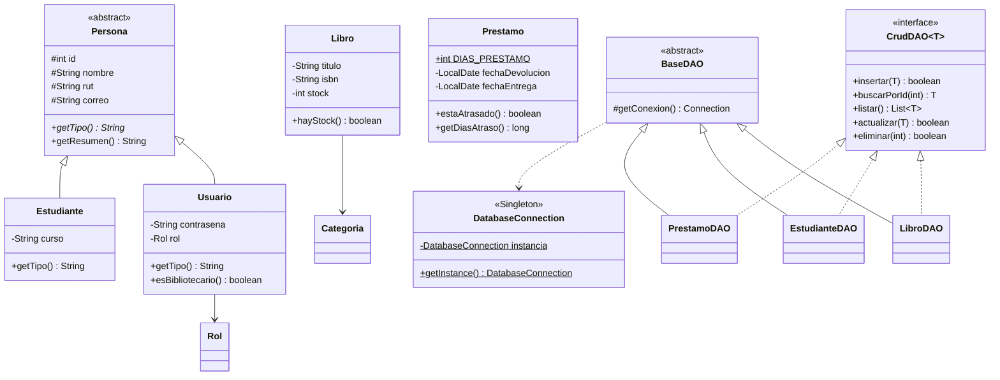

# Sistema de Gestión de Biblioteca Escolar

**Asignatura:** Desarrollo Orientado a Objetos II (PRY2203) — Duoc UC
**Evaluación Final Transversal — Semana 9**
**Autora:** Olga Rivas

## Descripción

Aplicación de escritorio en Java para controlar la circulación de libros de una biblioteca escolar:
registro, préstamo y devolución de libros para estudiantes, y gestión de inventario y usuarios
para el personal de la biblioteca.

Está hecha con **Java Swing (JFrame)**, se conecta a **MySQL por JDBC** y aplica los patrones
**MVC**, **DAO** y **Singleton**. El registro de préstamos corre en un **hilo en segundo plano**,
y la operación que modifica el stock está **sincronizada** (`synchronized`) para que no haya
condiciones de carrera.

## Requisitos

- Java 17 o superior
- MySQL 8 o superior
- IntelliJ IDEA (el proyecto es Maven; IntelliJ descarga solo el conector MySQL y JUnit)

## Cómo ponerlo en marcha

### 1. Crear la base de datos

Ejecutar los tres scripts de la carpeta `sql/`, **en este orden**, en MySQL Workbench o por consola:

| Orden | Script | Qué hace |
|-------|--------|----------|
| 1 | `PRY2203_EFT_S9_Script_crea_tablas_biblioteca.sql` | Crea la base `biblioteca` y sus 5 tablas (entregado por Duoc) |
| 2 | `PRY2203_EFT_S9_Script_poblado_tablas_biblioteca.sql` | Inserta los datos de ejemplo (entregado por Duoc) |
| 3 | `03_agrega_fecha_entrega.sql` | Agrega la columna `fecha_entrega` a `prestamos` (ver *Decisiones de diseño*). Se puede ejecutar más de una vez |

> Si solo se ejecutan los dos scripts de Duoc, la aplicación agrega la columna `fecha_entrega` sola
> la primera vez que se inicia, así que funciona igual.

```bash
mysql -u root -p --default-character-set=utf8mb4 < sql/PRY2203_EFT_S9_Script_crea_tablas_biblioteca.sql
mysql -u root -p --default-character-set=utf8mb4 < sql/PRY2203_EFT_S9_Script_poblado_tablas_biblioteca.sql
mysql -u root -p --default-character-set=utf8mb4 < sql/03_agrega_fecha_entrega.sql
```

### 2. Configurar la contraseña

Copiar `src/main/resources/db.properties.ejemplo` como `db.properties` en la misma carpeta y
completar la contraseña de MySQL:

```properties
url=jdbc:mysql://localhost:3306/biblioteca?useSSL=false&allowPublicKeyRetrieval=true&serverTimezone=America/Santiago&characterEncoding=UTF-8
usuario=root
clave=la_contraseña_de_tu_MySQL
```

`db.properties` está en el `.gitignore`: **la contraseña no se sube al repositorio**.

### 3. Ejecutar

- **Desde IntelliJ:** abrir la carpeta del proyecto, esperar que Maven cargue y ejecutar
  `cl.duoc.biblioteca.Main`.
- **Con el ejecutable:** en el panel Maven, `Lifecycle → package` genera `target/SistemaBiblioteca.jar`
  (con el conector MySQL incluido). Se abre con doble clic o con:
  ```bash
  java -jar target/SistemaBiblioteca.jar
  ```
  Si la contraseña de MySQL de ese computador es distinta, basta con dejar un `db.properties`
  en la carpeta desde donde se ejecuta el `.jar`: tiene prioridad sobre el que va dentro.
  `package` también ejecuta las pruebas; para generar el `.jar` sin MySQL encendido:
  ```bash
  mvn package -DskipTests
  ```

Si MySQL está apagado o la contraseña no corresponde, la aplicación avisa antes de abrir la ventana.

### Usuarios de prueba (datos de ejemplo)

| Rol | Correo | Contraseña |
|-----|--------|------------|
| Bibliotecario | `antonia@correo.cl` | `clave123` |
| Estudiante | `carlos@correo.cl` | `clave123` |

## Funcionalidades por módulo

| Módulo de la pauta | Dónde está | Qué permite |
|--------------------|------------|-------------|
| 1. Autenticación | `VentanaLogin`, `UsuarioDAO.autenticar` | Valida correo y contraseña en la base y abre la ventana según el rol |
| 2. Gestión de libros | Pestañas **Libros** (`PanelLibros`) y **Categorías** (`PanelCategorias`) | Registrar, modificar, eliminar, visualizar y buscar libros con categoría, autor, editorial, ISBN y stock; mantener las categorías |
| 3. Gestión de estudiantes | Pestaña **Estudiantes** (`PanelEstudiantes`) | Registrar estudiantes y, con una contraseña, crearles su cuenta de usuario |
| 4. Préstamos y devoluciones | Pestaña **Préstamos** (`PanelPrestamos`) | Verificar disponibilidad, registrar préstamos con vencimiento automático (7 días), registrar devoluciones y detectar el atraso |
| 5. Reportes | Pestaña **Reportes** (`PanelReportes`) | Libros más prestados, historial por estudiante, libros actualmente en préstamo y devoluciones con atraso |

**Roles:** el **bibliotecario** tiene gestión total (las seis pestañas). El **estudiante** solo
puede consultar el catálogo y pedir o devolver sus propios préstamos (pestañas *Catálogo* y
*Mis préstamos*).

## Arquitectura

Toda acción sigue el mismo recorrido; ninguna ventana escribe SQL y ningún DAO abre una ventana:

```
Vista (Swing)  →  Controlador  →  DAO  →  MySQL
  lo que se ve     las reglas     el SQL    los datos
```

```
src/main/java/cl/duoc/biblioteca/
├── Main.java                         Punto de entrada: comprueba la base y abre el login
├── conexion/
│   └── DatabaseConnection.java       Singleton: única conexión a MySQL
├── modelo/                           (M de MVC)
│   ├── Persona.java                  Clase abstracta: id, nombre, RUT, correo
│   ├── Usuario.java                  extends Persona: contraseña y rol
│   ├── Estudiante.java               extends Persona: curso
│   ├── Rol.java                      enum BIBLIOTECARIO / ESTUDIANTE
│   ├── Libro.java, Categoria.java
│   ├── Prestamo.java                 Vencimiento, atraso y estado
│   └── LibroMasPrestado.java         Fila del reporte de más prestados
├── dao/                              (patrón DAO)
│   ├── CrudDAO.java                  Interfaz genérica CrudDAO<T> con el CRUD
│   ├── BaseDAO.java                  Clase abstracta: conexión desde el Singleton
│   └── LibroDAO, EstudianteDAO, CategoriaDAO, UsuarioDAO, PrestamoDAO
├── controlador/                      (C de MVC)
│   ├── ControladorBiblioteca.java    Reglas del negocio entre la vista y los DAO
│   └── ServicioPrestamos.java        Operaciones que cambian el stock: synchronized + transacción
└── vista/                            (V de MVC)
    ├── VentanaLogin.java, VentanaPrincipal.java
    ├── PanelCrud.java                Clase abstracta base de los paneles
    ├── PanelLibros, PanelCategorias, PanelEstudiantes, PanelPrestamos, PanelReportes
    └── RenderEstadoPrestamo.java     Colorea los préstamos atrasados

src/test/java/                        Pruebas JUnit 5
sql/                                  Scripts de la base de datos
```

### Diagrama de clases (modelo y DAO)



*(Por espacio, el diagrama omite `CategoriaDAO` y `UsuarioDAO`, que siguen el mismo esquema.)*

## Programación orientada a objetos

| Concepto | Dónde |
|----------|-------|
| **Clases abstractas** | `Persona`, `BaseDAO`, `PanelCrud` |
| **Herencia** | `Usuario` y `Estudiante` extienden `Persona`; los cinco DAO extienden `BaseDAO`; los paneles extienden `PanelCrud` |
| **Polimorfismo** | `getTipo()` es abstracto en `Persona` y cada subclase lo sobrescribe; `getResumen()` lo usa sin saber qué subclase tiene. Cada DAO implementa a su manera los métodos de `CrudDAO` (`@Override`) |
| **Interfaces** | `CrudDAO<T>`, implementada por los cinco DAO |
| **Encapsulamiento** | Atributos privados con getters y setters en todos los modelos |

## Patrones de diseño

- **MVC:** paquetes `modelo`, `vista` y `controlador`. Las ventanas solo muestran y piden; el
  controlador aplica las reglas (por ejemplo, no eliminar un libro con préstamos en su historial).
- **DAO:** un DAO por entidad, el único que escribe SQL. Todos implementan `CrudDAO<T>` y usan
  `PreparedStatement` (protege contra inyección SQL).
- **Singleton:** `DatabaseConnection` tiene constructor privado, una instancia estática y
  `getInstance()`, que es `synchronized` para que dos hilos no creen dos conexiones.

## Concurrencia y control de consistencia

- **Hilo en segundo plano:** al registrar un préstamo o una devolución, `PanelPrestamos` lanza un
  `SwingWorker`. El registro del préstamo, el descuento del stock y la actualización del historial
  ocurren en ese hilo, y la ventana sigue respondiendo; mientras tanto se desactivan los botones y
  se muestra el avance con una barra de progreso.
- **Sincronización:** todos los métodos que modifican el stock están en `ServicioPrestamos` y son
  `synchronized`: `registrarPrestamo()`, `registrarDevolucion()` y `actualizarLibro()`. Si varios
  hilos piden el mismo libro a la vez, entran de a uno: la revisión del stock, el descuento y el
  registro ocurren juntos, y nunca se presta un ejemplar que no hay. Al editar un libro, solo se
  guarda si su stock no cambió desde que se cargó en el formulario, para no pisar un préstamo hecho
  mientras tanto.
- **Transacción:** los pasos de cada operación se confirman juntos (`commit`) o se deshacen juntos
  (`rollback`). Además, el `UPDATE` del stock exige `stock + cambio >= 0`, así que el stock nunca
  queda negativo.
- **Prueba:** `ServicioPrestamosTest` lanza 10 hilos que piden al mismo tiempo un libro con 3
  ejemplares; comprueba que solo 3 lo consiguen y que el stock termina en 0. Se repite 3 veces.

## Pruebas

En IntelliJ: clic derecho en `src/test/java` → **Run 'All Tests'** (o `mvn test`).

- Las pruebas del modelo (`PrestamoTest`, `PersonaTest`) no necesitan base de datos.
- Las de los DAO, el controlador y el servicio de préstamos usan MySQL. Crean sus propios
  registros (ISBN `TEST-…`, RUT `9999999…`) y los borran al terminar, sin tocar los datos de ejemplo.
  Si MySQL no está encendido, se omiten en vez de fallar.

## Decisiones de diseño

- **`fecha_entrega`:** la pauta pide detectar el atraso y *dejar constancia* de él, pero la tabla
  `prestamos` solo guarda el vencimiento (`fecha_devolucion`). Se agregó la columna `fecha_entrega`
  con un script aparte, sin modificar los scripts entregados. Los préstamos de ejemplo ya devueltos
  quedan con esa fecha vacía.
- **Usuarios y estudiantes se relacionan por RUT:** las dos tablas no tienen clave foránea entre sí.
  Al registrar un estudiante con contraseña, el sistema crea su cuenta de usuario con el mismo RUT,
  y así sabe qué historial mostrarle cuando inicia sesión.
- **No se eliminan libros ni estudiantes con préstamos:** se perdería el historial que pide la pauta.
- **Un estudiante no puede tener dos veces el mismo libro sin devolverlo.**
- **Pausa de demostración:** `PanelPrestamos` hace una pausa de 0,7 s entre los pasos del hilo
  (`PAUSA_DEMOSTRACION_MS`), solo para que en la demostración se vea el avance y que la ventana
  sigue respondiendo. No afecta a la lógica ni a las pruebas.
- **Conexión única compartida:** como pide la pauta, hay una sola conexión (Singleton). Las
  operaciones que escriben en varias tablas a la vez están en `ServicioPrestamos`, sincronizadas y
  dentro de una transacción. Limitación conocida: mientras dura esa transacción (milisegundos), otra
  escritura hecha desde la interfaz usaría la misma conexión; en un sistema con muchos usuarios
  simultáneos se usaría un *pool* de conexiones en lugar de una sola.
- **Categorías con libros no se eliminan:** primero hay que cambiar esos libros de categoría.
